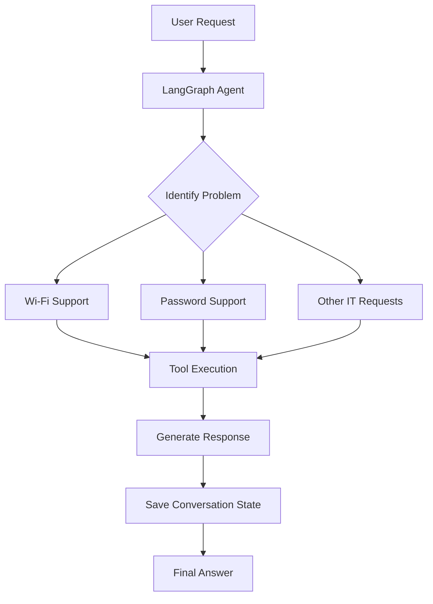

# 🎓 University IT Helpdesk AI Agent

### Python · LangGraph · LangChain · SQLite · pytest

An AI-powered IT helpdesk assistant developed as part of the **Artificial Intelligence (CSS-4007)** course at **Narxoz University**.

This project demonstrates how to build an AI agent that can process user requests, use external tools, maintain conversation memory, and provide IT support.

---

## 👩‍💻 My Implementation

I independently implemented the following features:

- **Workflow Design:** Built a LangGraph workflow with nodes and conditional edges.
- **Request Classification:** Added routing for Wi-Fi, password, and other IT problems.
- **Tool Integration:** Implemented tools to find instructions, check service status, and prepare support tickets.
- **AI Integration:** Connected an LLM to generate responses and use tools.
- **Persistent Memory:** Used SQLite to save conversation state and user preferences.
- **Automated Testing:** Added tests using pytest to check the system's behavior.

---

## 🛠️ Tech Stack

| Category | Technologies |
|---|---|
| Programming | Python |
| AI Framework | LangGraph, LangChain |
| AI Model | OpenAI API |
| Database | SQLite |
| Data Format | JSON |
| Testing | pytest |
| Version Control | Git, GitHub |

---

## ⚙️ How It Works



---

## 🎯 Skills Demonstrated

- Python programming
- AI agent development
- Workflow automation
- Conditional logic and routing
- Tool integration
- Conversation memory
- Automated testing
- Debugging and problem-solving

---

## 📚 Academic Information

**University:** Narxoz University  
**Course:** CSS-4007 — Artificial Intelligence  
**Project:** Homework 5 — IT Helpdesk Agent  
**Type:** Individual University Assignment

---

## 📄 Original Assignment

The original assignment instructions, setup requirements, and project specifications are provided below.

---


# HW5 — Build a university IT helpdesk with LangGraph

**CSS-4007 · Artificial Intelligence**  
**Due:** 8 November 2026, 23:59 (UTC+5)

## Start from this repository

1. Fork [ardakshalkar/css4007-hw5](https://github.com/ardakshalkar/css4007-hw5) and keep your fork public, as for the earlier homeworks.
2. Clone your fork and work there. Do not open a pull request to the starter repository.
3. Read [SCENARIOS.md](SCENARIOS.md) to see the example conversations and what the finished application should do.
4. Read [data/README.md](data/README.md), then inspect the supplied JSON files. Use these fixtures for your demonstrations.
5. Write your code and fill in SUBMISSION.md as you complete the parts. The starter supplies the task and data; you implement the graph, tools, memory and tests.

### Set up your environment

Create a virtual environment with python -m venv .venv. Activate it with .venv\Scripts\Activate.ps1 in PowerShell, or source .venv/bin/activate on macOS/Linux. Then run python -m pip install -r requirements.txt.

Part 1 needs no API key. For the model parts, copy .env.example to .env and set your key and an available tool-capable model identifier. The dependency list includes the OpenAI adapter; if you choose another provider, replace it with the appropriate adapter and document your setup. The SQLite checkpoint package is supplied for a local storage option; explain your final storage choice.

The starter dependencies are not a tested, pinned environment for a completed application. Pin the versions you actually use once your code runs, and record your Python version. No application entry point is supplied: include your own exact run commands in your README.

## The scenario

A university IT helpdesk receives messages such as “I cannot connect to Wi-Fi” and “I forgot my password.” The assistant should find the relevant instructions, check whether a service is down, and help prepare a support ticket if the problem remains unresolved. When a user returns, it should remember the conversation and their saved preference for the language of replies.

Build this assistant in stages using **LangGraph**. Start with a small program whose route you can explain. Then add model decisions, tools and memory. A terminal application is enough.

This is a practice version of a real helpdesk workflow. Use the supplied fictional helpdesk information and invented users. It does not connect to the university's systems or submit real tickets.

## Part 1 — Understand how a graph makes a decision

First build a small helpdesk graph **without an LLM**. It handles only Wi-Fi questions and password questions.

Your graph must follow this structure:

```text
START → read_request → choose the next node
                         ├─ wifi_help     → END
                         ├─ password_help → END
                         └─ other_help    → END
```

Use these routing rules:

- If the message contains `wifi` or `wi-fi`, send it to `wifi_help`.
- Otherwise, if it contains `password`, send it to `password_help`.
- Otherwise, send it to `other_help`, which asks the user whether the problem concerns Wi-Fi or a password.
- Ignore differences between uppercase and lowercase letters.

The two help nodes should return the corresponding instructions from `data/helpdesk.json`. Use separate LangGraph nodes and a conditional edge.

### Decide what your state holds

Use at least these fields:

| Field | What it holds |
| --- | --- |
| `message` | The user's original message |
| `category` | The category identified by `read_request` |
| `reply` | The response produced by a help node |

Before writing code, draw the graph and answer:

1. What information does each node need to read? What does it change?
2. What is the difference between a node returning an update to the state and a conditional edge choosing the next node?
3. Does the next node receive only the previous node's update, or the current graph state?
4. What do `START`, `END`, and compiling a graph mean in this program?

### Predict, run, explain

Predict the route for each message before running your code:

- `I cannot connect to Wi-Fi.`
- `I forgot my PASSWORD.`
- `My laptop screen is broken.`
- `My Wi-Fi password does not work.`

Then run all four. For each run, save the order of nodes and the state after each node. Compare it with your prediction. Explain what happens when a message mentions both Wi-Fi and a password, and which rule causes that result.

Now change the graph: when both topics appear, send the request to a new `clarify_problem` node that asks which problem the user wants to solve first. Show the changed graph and the new execution trace.

Finish by explaining **what LangGraph controls here** and **what your own Python functions decide**. There is no model making decisions in this part.

## Part 2 — Let a model choose tools

Extend the same helpdesk with a model that can use three reusable tools:

| Tool | What it does |
| --- | --- |
| `find_instructions` | Looks up Wi-Fi or password instructions in the local helpdesk data |
| `check_service_status` | Looks up whether the requested service is operating or has a known outage |
| `prepare_ticket` | Produces a local ticket draft from the problem description and steps already tried |

Each tool must work when called directly, without the agent. Then connect the tools to the model through your graph. A ticket is a draft saved locally; no message is sent to a real helpdesk.

Show one request that needs more than one tool. For example: “Wi-Fi still does not work after I followed the instructions. Is it down? If it is working, help me prepare a ticket.” The assistant's choice should depend on the tool results.

Draw the execution loop: the model requests a tool, your program runs it, its result returns to the model, and the model either continues or answers. Include a limit so the loop cannot run forever, and explain where you enforce it.

In `SUBMISSION.md`, explain:

1. How does the graph decide between running a tool and ending with an answer?
2. Which component requests a tool, and which component actually executes it?
3. What changes in the state after a tool result returns?
4. What makes this part different from the fixed routing rules in Part 1?

Save an actual run showing the model requests, tool results, and final answer. State which model and provider you used. Use the supplied service-status snapshots to show that the same conditional request leads to different behaviour when Wi-Fi is operating, down, or its status is unknown. See SCENARIOS.md for the interactions.

## Part 3 — Remember the user and the conversation

Add two separate kinds of memory:

- **Conversation memory:** the current problem, previous messages and steps already tried in this conversation.
- **User memory:** a saved preference, such as “reply in Kazakh,” that is available in a later conversation for the same invented user.

Use a LangGraph checkpointer to save conversation state, and persistent storage for the user preference. Explain what a `thread_id` identifies and how it differs from a user identifier. Memory must survive closing and restarting the program.

Demonstrate these situations:

1. A user reports a Wi-Fi problem, then says “I already tried that.” The assistant uses the earlier messages to understand what “that” means.
2. Close the program and start it again. Resume the same conversation with its previous state.
3. Start a new conversation for the same invented user. The saved language preference is available, while the previous conversation is a separate thread.
4. Start a conversation for a different invented user. The first user's preference must not appear.

For each demonstration, show what was read from conversation memory, user memory, or the helpdesk reference file. Explain why looking up Wi-Fi instructions is retrieval, while recalling the user's chosen language is memory.

## Part 4 — Make it easy for someone else to run your work

This means another person can download your code, follow your instructions, and run the same demonstrations on their computer.

In your repository:

1. Add a `README.md` with the exact steps to install the required packages, configure a model API key, start the program, and run the examples. State your Python version.
2. Include a dependency file with the package versions you used. Do not make the reader guess which LangGraph version works with your code.
3. Explain where memory files are saved and how to clear them to start again.
4. Add tests that check routing, the three tools, saved memory after a restart, and separation between users and conversations. Explain what each test would catch if the code broke.
5. Set up GitHub Actions to run these tests automatically whenever you push changes. This is continuous integration, or CI. The tests must work without a private model API key; you may substitute a clearly labelled fake model in tests. Keep the real model demonstration from Part 2 separate.
6. Commit as you complete each stage, with messages explaining what changed.

Keep API keys in environment variables or an ignored `.env` file. Do not commit keys, live memory databases, or personal information. Use invented identifiers such as `demo-user-a` and `demo-user-b` in your saved examples.

## Demonstrate the finished application

Run S01–S14 from data/scenarios.json. Follow reset and restart events as explained in data/README.md. Fill in the scenario table in SUBMISSION.md and save your own logs. SCENARIOS.md shows the expected user experience; it is not a set of measured results.

## What to hand in

Submit your repository link. It should contain:

- Your LangGraph code for all four parts.
- `SUBMISSION.md` with your drawings, explanations and predictions compared with actual runs.
- Small execution logs in `outputs/` showing which nodes and tools ran and what changed in the state.
- Setup instructions, a dependency file, tests and the GitHub Actions workflow.

Push your finished work to your public fork and submit its link on the LMS. The exact HW5 LMS submission destination is still to be provided by the professor.

## References

- [LangGraph Graph API](https://docs.langchain.com/oss/python/langgraph/graph-api)
- [LangGraph persistence](https://docs.langchain.com/oss/python/langgraph/persistence)
- [LangGraph memory](https://docs.langchain.com/oss/python/langgraph/add-memory)


---

## My Implementation — Setup and Run

### Python version

This project was developed using Python 3.12.0.

### Installation

Clone the repository and open the project folder.

Create a virtual environment:

```bash
python -m venv .venv
```

Activate it on macOS or Linux:

```bash
source .venv/bin/activate
```

Activate it on Windows PowerShell:

```powershell
.venv\Scripts\Activate.ps1
```

Install the required packages:

```bash
python -m pip install -r requirements.txt
```

### API key configuration

Copy the example environment file:

```bash
cp .env.example .env
```

Open `.env` and add your OpenAI API key and model name.

The `.env` file is ignored by Git and must not be committed.

Part 1 does not need an API key. Parts 2 and 3 use an OpenAI model.

### Run the examples

Run the fixed routing graph:

```bash
python part1.py
```

Run the original routing graph:

```bash
python part1_original.py
```

Run the model and tools:

```bash
python part2.py
```

Run conversation memory:

```bash
python part3.py
```

Save a user language preference:

```bash
python user_memory.py
```

Test saved conversation memory:

```bash
python check_memory.py
```

Test user preferences and separate conversations:

```bash
python test_user_memory.py
```

### Memory storage

Conversation memory and user preferences are saved in:

`outputs/memory.db`

The application uses SQLite for persistent storage.

To clear the saved memory, close the program and delete `outputs/memory.db`.

The database is created again when the memory program starts.

### Execution logs

Saved execution traces are available in the `outputs/` folder.

- `part1_trace.txt` — fixed routing.
- `part1_original_trace.txt` — original routing.
- `part2_trace.txt` — model and tools.
- `part3_restart_trace.txt` — persistent conversation memory.
- `part3_users_trace.txt` — separate users and language preferences.

### Test data

The project uses fictional information from the `data/` folder.

No real university services are accessed, and tickets are local drafts only.

