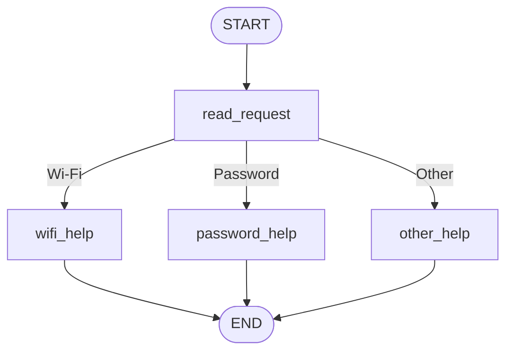
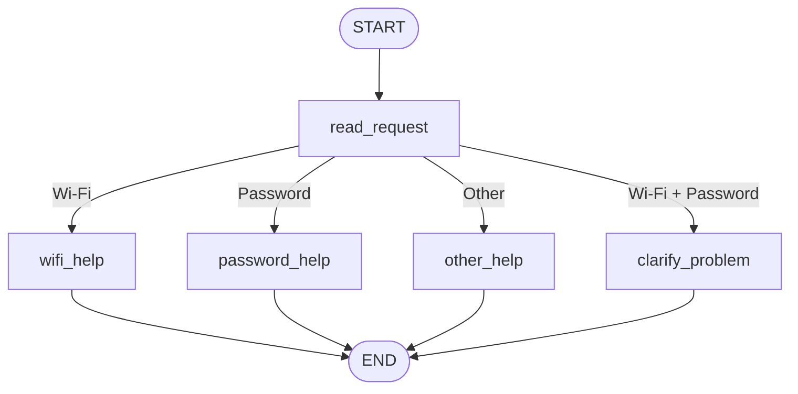
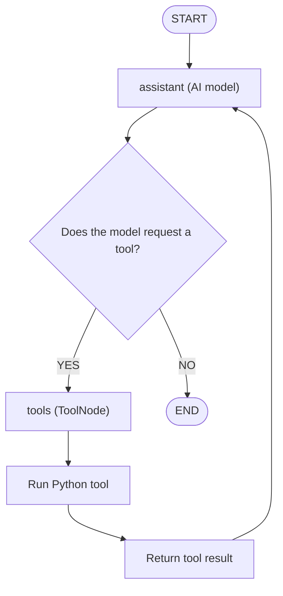

# HW5 — My LangGraph helpdesk

## Part 1 — How the graph works

### My graph and state

My program uses LangGraph to help students with IT problems.

The original graph has these nodes:



The graph state has three fields:

message: the user's original message.

category: the type of problem.

reply: the answer for the user.

1. What information does each node read and change?

read_request reads the message and updates category. The wifi_help and password_help nodes use instructions from helpdesk.json and update reply. The other_help node asks the user to choose Wi-Fi or password.

2. What is the difference between a node and a conditional edge?

A node updates the state. A conditional edge chooses the next node.

3. What does the next node receive?

The next node receives the current graph state, not only the last update.

4. What do START, END, and compile() mean?

START begins the graph. END finishes it. compile() makes the graph ready to run.


### Predictions before running

| Message | Predicted route | Actual route | What I learned |
| --- | --- | --- | --- |
| I cannot connect to Wi-Fi. | read_request → wifi_help | read_request → wifi_help | Wi-Fi is detected correctly. |
| I forgot my PASSWORD. | read_request → password_help | read_request → password_help | Uppercase letters do not change the result. |
| My laptop screen is broken. | read_request → other_help | read_request → other_help | Unknown problems go to other_help. |
| My Wi-Fi password does not work. | read_request → wifi_help | read_request → wifi_help | Wi-Fi has priority over password. |

In the original graph, Wi-Fi has priority because the Python function checks Wi-Fi before password. If both words are found, the first condition is true, so the graph chooses wifi_help.

### My change to the graph

I added a new node called `clarify_problem`.

The modified graph is:



When a message contains both Wi-Fi and password, the graph uses `clarify_problem`.

The original route was:

`START → read_request → wifi_help → END`

The new route is:

`START → read_request → clarify_problem → END`

The new reply is:
"Do you need help with Wi-Fi or password first?"

The other three messages still use the same routes.

### Execution traces

Original graph: `outputs/part1_original_trace.txt`

Modified graph: `outputs/part1_full_trace.txt`

Both files show the executed nodes and the full state after each step.

### LangGraph and Python

LangGraph controls the graph flow, state updates, and execution order.

My Python functions read the message, check keywords, choose a category, and return instructions.

There is no AI model in Part 1. The graph uses simple Python rules.

## Part 2 — Model and tools

### 1. Model and provider

- Provider: OpenAI
- Model: gpt-4.1-mini
- Framework: LangGraph and LangChain

I connected the AI model to three tools. The model chooses tools based on the user's message and the tool results.

### 2. Model and tool execution loop




The model requests a tool. ToolNode runs the Python function and returns the result. The model can then use another tool or give a final answer.

### 3. Answers to the four questions

**1. How does the graph decide between running a tool and ending?**

The `choose_next` function checks the last AI message. If the model requests a tool and the limit is not reached, the graph runs the tool. Otherwise, it ends.

**2. Who requests and executes the tools?**

The AI model requests a tool. ToolNode executes the Python function.

**3. What changes in the state after a tool result?**

The `messages` field receives the tool result. The `tool_steps` field counts the tool calls.

**4. What is different from Part 1?**

In Part 1, Python rules choose the next node. In Part 2, the AI model chooses which tools to use.

### 4. Direct tool tests

I tested three tools:

1. `check_service_status` — checks the status of a fictional university service.
2. `find_instructions` — finds Wi-Fi and password instructions from `helpdesk.json`.
3. `prepare_ticket` — creates a local JSON ticket draft using `ticket_template.json`.

All three tools worked successfully.

### 5. Actual model and tool execution

I tested the AI helpdesk with different service-status profiles.

**Normal profile**

- The model checked the Wi-Fi status.
- The service was operational.
- The model found troubleshooting instructions.
- The model created a local ticket draft.

**Wi-Fi outage profile (S07)**

- The model checked the Wi-Fi status.
- The service status was `outage`.
- The model explained the outage.
- No ticket was created.

**Status unavailable profile (S08)**

- The model checked the Wi-Fi status.
- The service status was `unknown`.
- The model asked the user for permission before creating a ticket.
- No ticket was created.

**Two-message conversation (S06)**

- The user first asked for Wi-Fi instructions.
- The model called `find_instructions`.
- The user then explained that Wi-Fi still did not work.
- The model checked the service status.
- The service was operational.
- The model created a local ticket draft.

**Missing information (S09)**

- The user first asked to prepare a ticket.
- The model asked for the problem and steps already tried.
- The user provided the missing information.
- The model checked the Wi-Fi status.
- The model created a local ticket draft using the provided details.

**Account recovery outage (S14)**

- The model checked the account recovery service.
- The service status was `outage`.
- The model explained the problem.
- No ticket was created.

### 6. Loop limit

I set `MAX_TOOL_STEPS = 4`.

The `assistant` function checks the limit before allowing new tool requests. The `run_tools` function counts tool calls and updates `tool_steps`.

The `choose_next` function checks whether another tool call is allowed.

This limit helps prevent an endless tool loop.

### 7. Execution trace

The program prints:

- Model tool requests
- Tool arguments
- Tool results
- Final AI answers

The execution trace is saved in:

`outputs/part2_trace.txt`

All tickets are saved as local JSON drafts in `outputs/tickets/`. No real university tickets are submitted.

## Part 3 — Memory

### 1. Conversation memory and user memory

I used two types of memory in my AI helpdesk.

**Conversation memory** stores previous messages and the current problem. I used a LangGraph SQLite checkpointer to save the conversation state.

**User memory** stores the user's preferred language. I used a SQLite table called `user_preferences`.

Both types of memory are stored in `outputs/memory.db`. The data stays saved after restarting the program.

### 2. Thread ID and user identifier

- `thread_id` identifies one conversation.
- `user_id` identifies one user.

One user can have different conversations. Each conversation has its own messages, but the user's language preference can be used in a new conversation.

### 3. Memory demonstrations

| Situation | Command used | Log file | What happened |
|---|---|---|---|
| Refer to an earlier message | `python part3.py` | Terminal output | The assistant understood "I already tried that" using earlier messages. |
| Close, restart and resume | `python check_memory.py` | `outputs/part3_restart_trace.txt` | SQLite restored 9 saved messages from `s10`. |
| Same user, new conversation | `python test_user_memory.py` | `outputs/part3_users_trace.txt` | User A received a Kazakh answer in thread `s11`. |
| Different user | `python test_user_memory.py` | `outputs/part3_users_trace.txt` | User B received an English answer in thread `s12`. |

### 4. Conversation memory test

I tested two messages in conversation `s10`.

**First message:**

"My Wi-Fi does not work. What should I try?"

The assistant used `find_instructions` to read Wi-Fi instructions from `helpdesk.json`.

**Second message:**

"I already tried that."

The assistant used previous messages to understand the problem. It checked the Wi-Fi status and offered more help.

### 5. Memory after restarting

I ran `check_memory.py` in a new Python process.

The saved conversation was loaded from SQLite.

**Result:**

```text
Saved messages: 9
User: My Wi-Fi does not work. What should I try?
User: I already tried that.
```

The old conversation was available after restarting the program.

### 6. Same user and different user

I saved the preferred language for `demo-user-a` as Kazakh.

In a new conversation `s11`, the assistant replied in Kazakh.

For `demo-user-b`, there was no saved language preference. The assistant replied in English in conversation `s12`.

I also checked that the previous Wi-Fi conversation was not copied into the new conversation.

**Result:**

`Old Wi-Fi conversation found: False`

### 7. Memory and retrieval

| Information | Source |
|---|---|
| Earlier messages and Wi-Fi problem | Conversation memory |
| Saved language preference | User memory |
| Wi-Fi troubleshooting instructions | `helpdesk.json` |
| Wi-Fi service status | `service_status.json` |

Looking up Wi-Fi instructions is **retrieval** because the assistant reads information from a reference file.

Remembering the preferred language is **memory** because the preference was saved for a user and reused in another conversation.

### 8. Saved files

- `part3.py` — conversation memory with LangGraph.
- `check_memory.py` — checks saved conversation state.
- `user_memory.py` — saves the user's language.
- `test_user_memory.py` — tests different users and conversations.
- `outputs/memory.db` — SQLite database.
- `outputs/part3_restart_trace.txt` — saved restart test.
- `outputs/part3_users_trace.txt` — saved user memory tests.

## Part 4 — Running and checking my work

My project uses Python 3.12.0, LangGraph, LangChain, OpenAI and SQLite.

The `README.md` file explains how to install packages, configure the API key, and run the project. The `requirements.txt` file contains the package versions.

I store my OpenAI API key in `.env`. This file is excluded from Git using `.gitignore`.

### Memory storage and reset

I use SQLite to save conversation history and user preferences.

- `outputs/memory.db` — memory for Part 3.
- `outputs/scenario_memory.db` — memory for scenario demonstrations.

To clear the scenario memory, I can delete `outputs/scenario_memory.db`. My scenario runner also resets this database before each scenario.

### Automated tests

I created two test files:

- `tests/test_helpdesk.py`
- `tests/test_memory.py`

My tests check:

1. **Routing:** Detects incorrect Wi-Fi, password or unsupported-request routing.
2. **Instructions:** Detects missing or incorrect troubleshooting instructions.
3. **Service status:** Detects incorrect status results and unknown profiles.
4. **Ticket creation:** Checks that a local JSON ticket is created.
5. **Memory persistence:** Checks that saved state can be read after reopening the SQLite connection.
6. **Thread isolation:** Checks that different conversations do not share messages.
7. **User isolation:** Checks that different users do not share preferences.

I ran the tests using:

```bash
python -m pytest tests/ -v
```

All 9 automated tests passed.

The automated tests do not call the real OpenAI model. They check functions and SQLite storage without an API key. I used the real model separately for the Part 2 and Part 3 demonstrations.

### GitHub Actions

I created `.github/workflows/tests.yml`.

GitHub Actions automatically:

1. Installs Python 3.12.
2. Installs packages from `requirements.txt`.
3. Runs the automated tests without an API key.

The workflow completed successfully on GitHub.

I also made separate commits for implementation, documentation and tests.

---

## Choices and limitations

### My technical choices

I selected **LangGraph** because it supports nodes, conditional routing, tool execution and conversation memory.

I used **LangChain** to connect the OpenAI model with my tools.

I used **GPT-4.1-mini** because it supports tool calling.

I selected **SQLite** because it saves information locally and keeps data after the program stops. It does not require a separate database server.

I saved language preferences using `user_id`. I separated conversation history using both `user_id` and `thread_id`.

I used local JSON files for instructions, service status and ticket templates. This allows me to test the application without real university services.

### Limitations

1. The application uses fictional university helpdesk data.
2. Model responses can change between runs.
3. The model sometimes creates tickets before the user explicitly requests one.
4. The model can sometimes confuse recommended steps with completed steps.
5. SQLite storage is suitable for this demonstration but is not a complete production helpdesk system.
6. The automated memory test reopens SQLite in the same Python process. I used a separate scenario demonstration to test an actual process restart.

In the future, I could improve the application with stronger tool rules, additional validation and more automated tests.

---

## Supplied scenarios — my actual results

| Scenario | Command or manual steps | Log file | What happened / what I changed |
| --- | --- | --- | --- |
| S01 — Simple Wi-Fi route | `python part1_original.py` | `outputs/scenarios_part1_original.txt` | The graph selected `wifi_help` and returned Wi-Fi instructions. |
| S02 — Case-insensitive password route | `python part1_original.py` | `outputs/scenarios_part1_original.txt` | The graph recognized uppercase PASSWORD and selected `password_help`. |
| S03 — Unsupported request | `python part1_original.py` | `outputs/scenarios_part1_original.txt` | The graph selected `other_help` and asked for clarification. |
| S04 — Two topics before the graph change | `python part1_original.py` | `outputs/scenarios_part1_original.txt` | The original graph selected Wi-Fi even though both topics were mentioned. |
| S05 — Two topics after adding clarification | `python part1.py` | `outputs/scenarios_part1_updated.txt` | The updated graph selected `clarify_problem` and asked which issue to address first. |
| S06 — Instructions then local ticket | `python part2.py` | `outputs/scenarios_part2.txt` | The model used instructions, checked Wi-Fi status and created local ticket drafts. It also created a ticket too early in the first interaction. |
| S07 — The same request during a Wi-Fi outage | `python part2.py` | `outputs/scenarios_part2.txt` | The model detected a Wi-Fi outage and did not create a ticket in this demonstration. |
| S08 — Status source unavailable | `python part2.py` | `outputs/scenarios_part2.txt` | The model reported unknown status and requested permission before creating a ticket. |
| S09 — Missing ticket details | `python part2.py` | `outputs/scenarios_part2.txt` | The model asked for missing details and created a ticket after receiving them. |
| S10 — Use the current conversation | `python run_memory_scenarios.py` | `outputs/scenarios_part3_full.txt` | The model remembered that the user enabled Wi-Fi, forgot the saved network and attempted reconnection. |
| S11 — Persist and recall after restart | `python run_memory_scenarios.py` | `outputs/scenarios_part3_full.txt` | After a process restart, the model remembered the Wi-Fi problem and previous steps. It answered in Kazakh. |
| S12 — Preference across threads without replay | `python run_memory_scenarios.py` | `outputs/scenarios_part3_full.txt` | The saved Kazakh preference was available in a new conversation after restart. |
| S13 — Do not share memory between users | `python run_memory_scenarios.py` | `outputs/scenarios_part3_full.txt` | User B did not receive User A's previous problem or language preference. |
| S14 — Password recovery outage | `python part2.py` | `outputs/scenarios_part2.txt` | The model detected an account-recovery outage and reported that no repair time was available. |

### Final observations

The fixed routing graph worked correctly for simple requests. Adding a clarification node improved the handling of messages containing both Wi-Fi and password topics.

The model-based graph used all three tools. Different service-status profiles changed its decisions.

SQLite preserved conversation history after a process restart. User language preferences were also available across different threads without sharing them with another user.

All 9 automated tests passed locally, and GitHub Actions completed successfully.

The main remaining limitation is that the model can sometimes create unnecessary tickets or make assumptions about completed troubleshooting steps.

The Part 2 logs show the relevant service-profile demonstrations, but they are not a complete automated replay of every event in `data/scenarios.json`.
